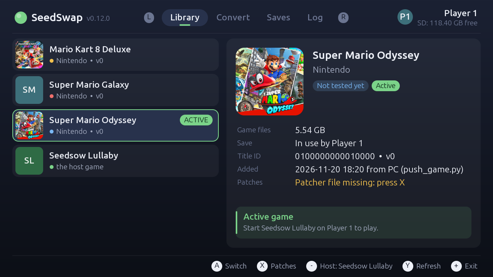
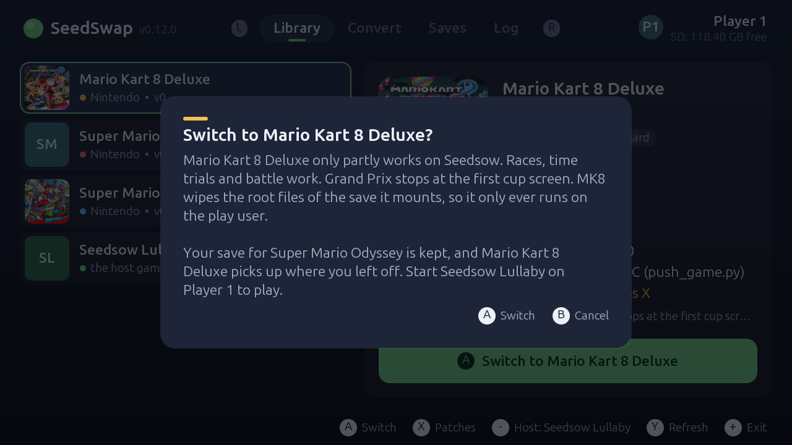
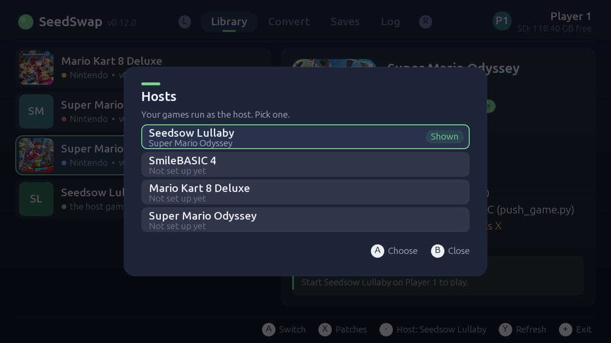
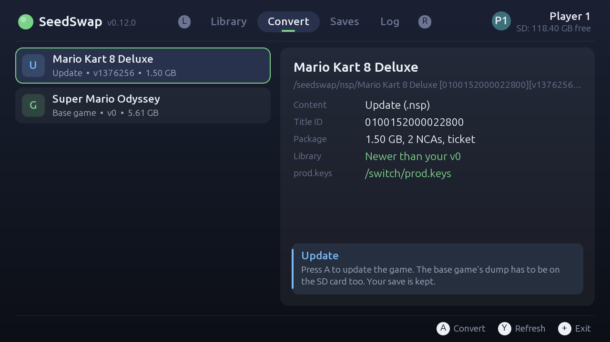
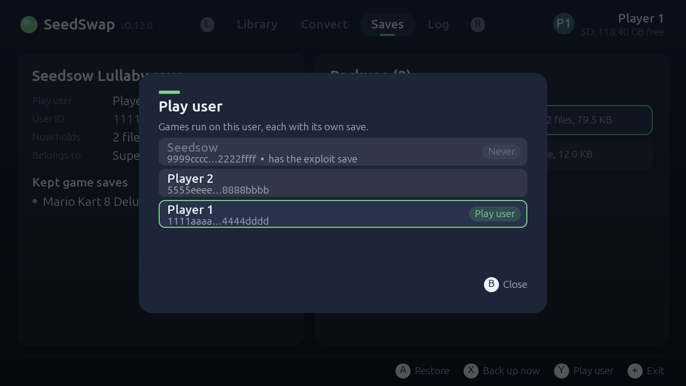
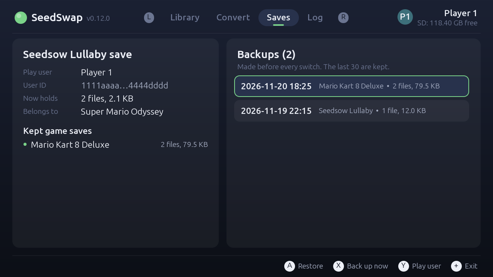
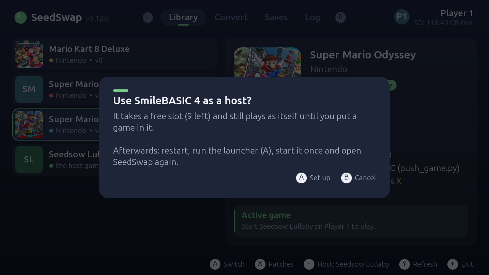

# SeedSwap

Play your Switch 1 games on a Switch 2. SeedSwap runs them in place of Seedsow Lullaby or another
Switch 1 game you have installed.

Needs firmware 23.0.1 and kaiHEN 20261123 (20261117.1 also works).

> [!WARNING]
> **SeedSwap can brick your console.** It's rare, but it can happen. SeedSwap runs on the same base
> as seedsow-semi-untethered and uses the same Seedsow file system code (Seedsow FS), so anything that
> can go wrong there can go wrong here too. Use it at your own risk.

| | |
|---|---|
|  |  |
|  |  |
|  |  |

*Screenshots from the PC preview. The users are made up.*

## Get started

1. Download `build.exe` and `seedswap.nro` from the [latest release](../../releases/latest). Without
   Windows, use Python instead of `build.exe`.
2. Follow **[INSTALL.md](INSTALL.md)**. No Seedsow? See its SmileBASIC 4 section.

> **Use only your own games and keys.** This repository has neither. Don't download them.

## What it does

- Converts your game dumps on the console, with their updates and DLC.
- Switches between games. Each game keeps its own save.
- Runs your games in place of Seedsow or any installed Switch 1 game (the host).
- Keeps your games away from other users' saves (the save guard).

## The save guard

A game running in place of another one could write to any user's save, including the exploit save.
The save guard stops that:

- Your games can only open the saves of the user who plays (Saves → Y in SeedSwap).
- For any other user, the game just finds no save.
- The user with the exploit save can never be picked.
- After picking the user, restart and run the launcher (A) once.

Refused saves are logged in `SD:/ns2jb-modloader/logs/`.

## Build it yourself

- **`seedswap.nro`:** GitHub Actions builds it on every push. To build it yourself, see
  `seedswap/README.md`.
- **Everything else:** `python3 build.py --nro seedswap.nro` (Python 3.8 or newer). `build.exe` is
  this same script with the repository's files inside.

`build.py` downloads three parts from their authors, because they can't be included here: alula's
launcher, seedsow-semi-untethered, and kurumuz's RO helper. It checks every file against
`SHA256SUMS.txt`.

## What's in this repository

| Path | What |
|---|---|
| `seedswap/` | SeedSwap's source |
| `save/` | our files for the Seedsow save (the A/B launcher entries, the loader start, and the kaiHEN stage, which takes kaiHEN 20261123's SD layout from seedsow-semi-untethered d2e6fac) |
| `sd/` | our SD card files (the loader stage and the install image) |
| `loader/` | our changes to ns2jb-modloader, and the image tools |
| `ns2jb-route/` | the command for SmileBASIC 4 and ns2jb (no Seedsow), with the ns2jb-modloader parts it uses |
| `build.py` | makes the save and SD files |
| `upload_save.py` | updates an existing seedsow-semi-untethered save over the network |

## Licences

- **GPL-2.0 (`LICENSE`)** for everything here except the parts below. `save/`, `sd/`, `loader/` and
  `ns2jb-route/` come from seedsow-semi-untethered and ns2jb-modloader, both GPL-2.0.
  `ns2jb-route/vendor/ns2jb-modloader/` keeps its own licence files (`VENDOR.md` lists them).
- **MIT:** seedsow-semi-untethered's CivSwitchFS part (`licenses/CivSwitchFS-MIT.txt`).
- **MIT or public domain:** `seedswap/source/vendor/stb_image.h`.
- **Ubuntu font licence:** `seedswap/source/font_data.c` and `seedswap/assets/fonts/`
  (`licenses/UBUNTU-FONT-LICENCE.txt`).
- **Downloaded files** keep their authors' terms.

## Credits

| Who | Project |
|---|---|
| alula | switch-artemis-launcher |
| rushinz | seedsow-semi-untethered |
| ItsNerisma | CivSwitchFS |
| kurumuz | ns2jb |
| SebaaMG | ns2jb-modloader |
| ouncebrew | kaiHEN, libounce, ounce-devkit |
| dougchansan | ns2-savekit |
